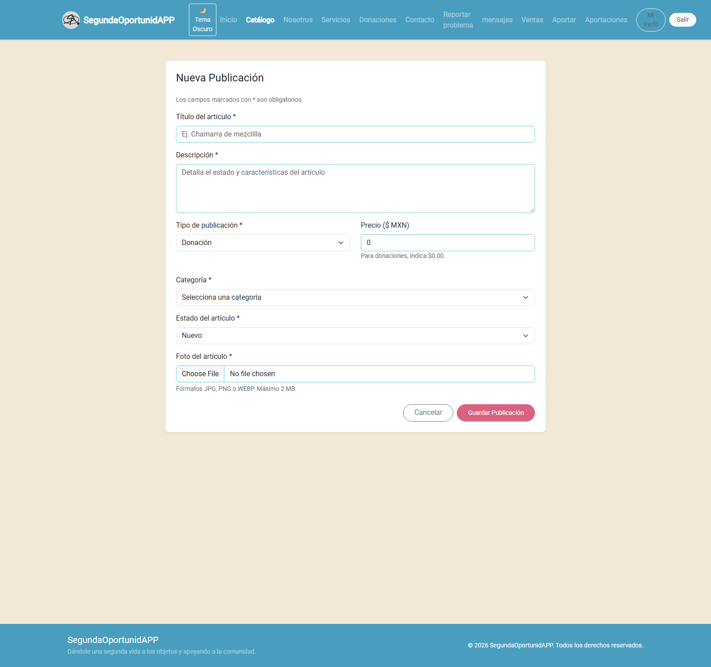
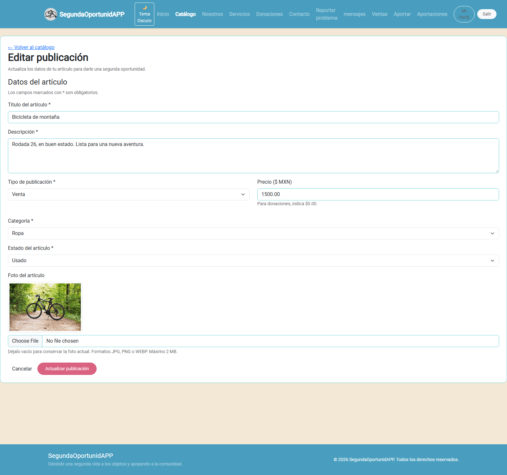
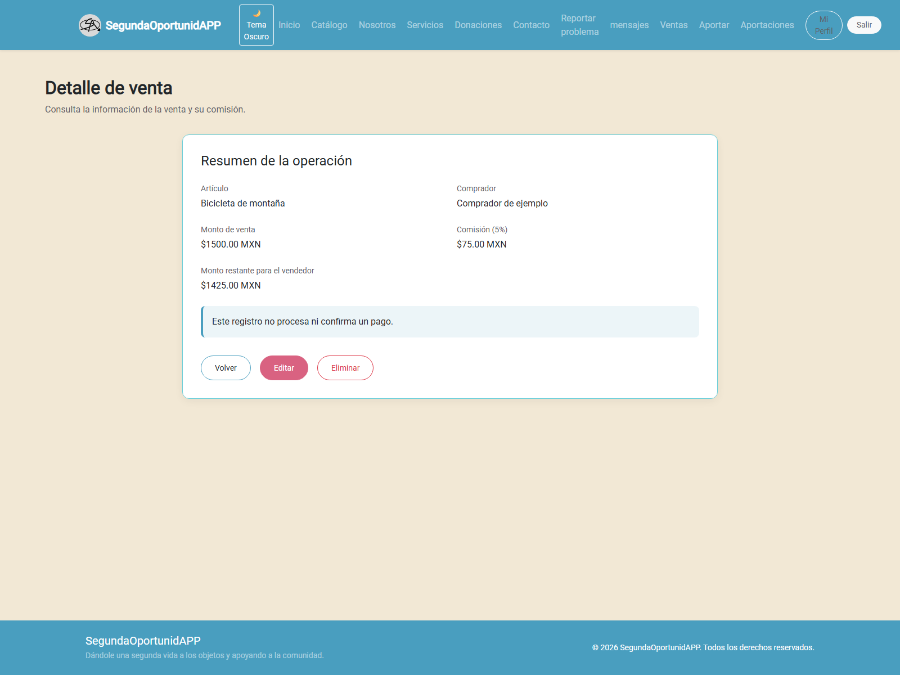

# SegundaOportunidAPP · Laravel

Proyecto académico de publicaciones, ventas y aportaciones. Las ventas se registran manualmente y se calcula la comisión; las aportaciones guardan su comprobante en la base de datos para revisión. **No hay pasarela de pagos, cobro real ni verificación automática**. La aplicación incluye inicio de sesión para usuarios, pero el módulo de transacciones todavía necesita controles de autorización. Utiliza solo datos de prueba y no lo despliegues con comprobantes reales.

## Requisitos

PHP 8.3 o superior con las extensiones `pdo_pgsql` y `pgsql`, Composer y PostgreSQL. Bootstrap se carga desde CDN.

## Instalación desde cero (PowerShell)

1. Crear una base de datos vacía en PostgreSQL, por ejemplo `segunda_oportunidad`, usando pgAdmin o `createdb`.
2. En la carpeta del proyecto:

```powershell
composer install
Copy-Item .env.example .env
```

3. Editar `.env`: completar `DB_HOST`, `DB_PORT`, `DB_DATABASE`, `DB_USERNAME` y `DB_PASSWORD` con los datos locales. No compartir ni subir `.env`.
4. Ejecutar:

```powershell
php artisan key:generate
php artisan migrate --seed
php artisan serve
```

Abrir la dirección que muestre Artisan. Para comenzar de nuevo con datos de ejemplo, usar `php artisan migrate:fresh --seed`. **Este último comando elimina todas las tablas y sus datos**; úsalo únicamente en una base de pruebas.

## Flujo de ejemplo

Crear una publicación de tipo venta con precio mayor que cero, abrir Ventas y registrar el comprador. El importe se toma del precio de la publicación y se guarda junto con la comisión y el saldo del vendedor. Una publicación admite una sola venta; para conservar la integridad, no puede borrarse mientras exista el registro de venta.

Desde Aportar se registran nombre, correo, monto, referencia única y comprobante PDF/JPG/PNG (máximo 2 MB). El archivo se guarda en la base como texto codificado y puede descargarse. Registrar un comprobante no demuestra que la operación se haya realizado. Se pueden consultar, editar y eliminar los registros.

`COMISION_PUNTOS_BASE=500` en `.env` representa un **5% de ejemplo**, no una tarifa aprobada: 100 puntos base equivalen a 1%. El equipo puede cambiar el valor de 0 a 10000 antes de registrar nuevas ventas. Cada venta conserva la tasa vigente en el momento de su registro; editar el comprador no altera sus importes. La comisión se redondea al centavo más cercano.

## Pruebas

Las pruebas utilizan SQLite en memoria por defecto al ejecutar `php artisan test`.

Después de adaptar las vistas de ventas y aportaciones a la guía de diseño, se ejecutaron 8 pruebas con SQLite en memoria y pasaron 90 verificaciones. Estas pruebas incluyeron que las pantallas del módulo cargaran sus estilos y acciones.

El 16 de noviembre de 2026 se probó el commit `0c6adcd` con PostgreSQL en una base de datos creada exclusivamente para pruebas. Se ejecutaron `php artisan migrate` y `php artisan migrate:fresh --seed` sin errores; después, las 7 pruebas pasaron con 62 verificaciones. Las pruebas abarcaron el cálculo de comisión, validaciones, comprobantes y acceso a las pantallas.

La rama recibió posteriormente un ajuste en `composer.lock` para compatibilidad con PHP 8.3. Se recomienda repetir las pruebas con PostgreSQL tras instalar las dependencias de la versión actual. El comando `migrate:fresh` elimina todas las tablas de la base configurada: úsalo solo en una base de pruebas independiente.


## Integrantes del equipo

- Anhil
- Luis
- Angel Daniel
- Marco
- Zayra
- Diego

## Aportaciones individuales por integrante

### Marco Antonio Zarco Espinoza — Ventas, comisiones y aportaciones

En este módulo me encargué de desarrollar el registro de ventas de artículos de segunda mano y el cálculo automático de la comisión correspondiente a SegundaOportunidAPP. Integré las ventas con las publicaciones para guardar en la base de datos el monto de la operación, el porcentaje aplicado, la comisión y el importe restante para el vendedor. También agregué una validación para evitar registrar dos ventas de la misma publicación y una protección para impedir que se elimine una publicación mientras tenga una venta registrada.

Además, elaboré un formulario para registrar aportaciones económicas con el nombre, correo, monto y referencia de la operación. Incorporé la carga y descarga de comprobantes en formato PDF, JPG o PNG, así como validaciones y mensajes de error en español. Implementé opciones para consultar, editar y eliminar los registros, y adapté las vistas al diseño y al footer del proyecto.

Para mantener la identidad visual de SegundaOportunidAPP, adapté los formularios, listados y detalles de ventas y aportaciones a la guía de diseño del equipo. Utilicé la paleta y tipografía del proyecto, espaciados consistentes y una distribución adaptable a computadoras y celulares. Conservé la navegación y el footer compartidos, e integré la confirmación de eliminación mediante eventos de JavaScript.

Por último, participé en la integración de los cambios recientes de `main` con la rama del módulo y en las pruebas de migraciones y funcionalidades con PostgreSQL. El registro de ventas y aportaciones es manual: todavía no realiza cobros ni verifica pagos automáticamente, y el módulo necesita controles de autorización antes de utilizar datos reales.

## Capturas del módulo de publicaciones

### Catálogo


### Crear publicación



### Detalle de publicación


### Editar publicación



## Capturas del módulo de ventas y aportaciones

Las capturas muestran la interfaz de la aplicación con datos ficticios.

### Listado de ventas


### Registrar una venta


### Detalle de una venta y su comisión



### Listado de aportaciones


### Registrar una aportación


### Detalle y comprobante de una aportación


