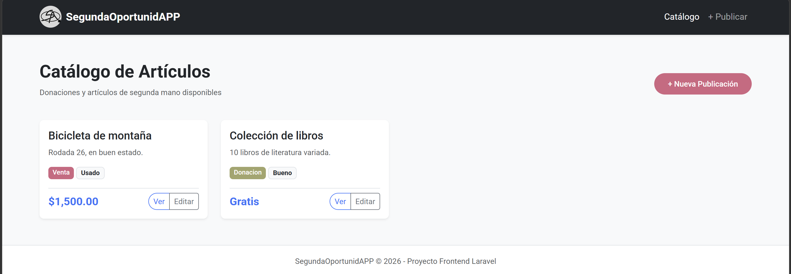
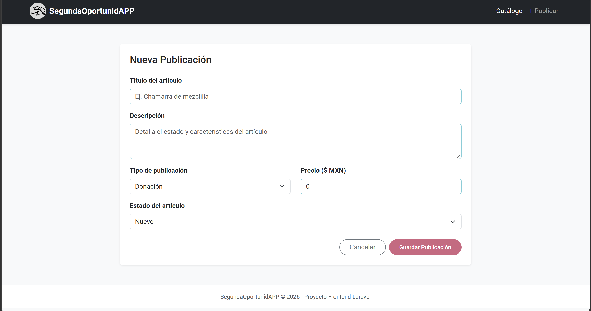
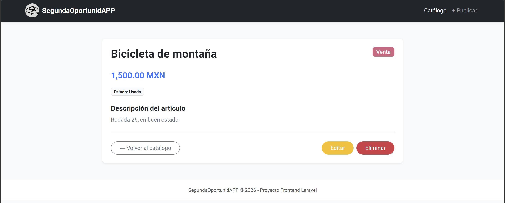
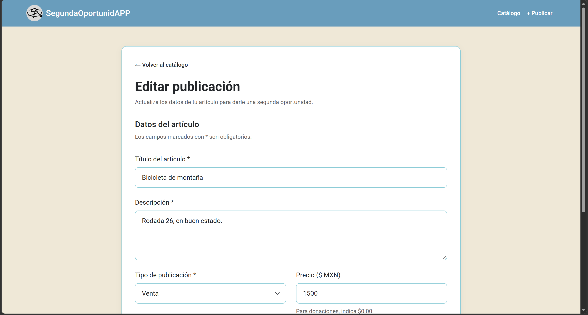

# SegundaOportunidAPP - Módulo Frontend CRUD (Laravel)

Plataforma web desarrollada en **Laravel** para la donación y venta de artículos de segunda mano, enfocada en darle una segunda vida a los objetos y apoyar a la comunidad.

Esta rama implementa un **CRUD completo de publicaciones** que simula el backend mediante arreglos guardados en sesión (`$request->session()`), sin necesidad de base de datos.

---

## Integrantes del Equipo

| Integrante | Rol | Archivo asignado |
| **Anhil** | Líder de proyecto y Layout Maestro | `layouts/app.blade.php`, `publicaciones/index.blade.php` |
| **Luis** | Lógica del controlador y manejo de sesiones | `PublicacionController.php` |
| **Angel** | Vista de creación de publicaciones | `create.blade.php` |
| **Marco** | Vista de edición de publicaciones | `edit.blade.php` |
| **Zayra** | Vista de detalle y eliminación | `show.blade.php` |
| **Diego** | Documentación, pruebas y presentación | `README.md` |

---

## Tecnologías

- **Laravel** (PHP) con motor de plantillas **Blade**
- **Bootstrap 5** y CSS personalizado
- **Sesiones de Laravel** como persistencia temporal
- **Git / GitHub** con flujo de ramas `feature/*`

---

## Requisitos e Instalación

**Requisitos previos:** PHP 8.1 o superior, Composer y Git.

1. **Clonar el repositorio:**

    ```bash
    git clone https://github.com/anhilvigueras-debug/SegundaOportunidAPP.git
    cd SegundaOportunidAPP
    ```

2. **Cambiarse a la rama de trabajo:**

    ```bash
    git checkout laravel-crud
    ```

3. **Instalar dependencias de PHP:**

    ```bash
    composer install
    ```

4. **Configurar el archivo de entorno:**

    ```bash
    cp .env.example .env
    php artisan key:generate
    ```

5. **Iniciar el servidor local de desarrollo:**

    ```bash
    php artisan serve
    ```

6. **Abrir en el navegador:** `http://127.0.0.1:8000/publicaciones`

---

## Tabla de Rutas HTTP (RESTful)

| Método HTTP | Ruta / URL | Acción del Controlador | Descripción |
| **GET** | `/publicaciones` | `index` | Muestra el catálogo de publicaciones en sesión. |
| **GET** | `/publicaciones/create` | `create` | Muestra el formulario para crear una publicación. |
| **POST** | `/publicaciones` | `store` | Procesa y guarda una nueva publicación en sesión. |
| **GET** | `/publicaciones/{id}` | `show` | Muestra el detalle de una publicación. |
| **GET** | `/publicaciones/{id}/edit` | `edit` | Muestra el formulario precargado para editar. |
| **PUT/PATCH** | `/publicaciones/{id}` | `update` | Actualiza la información en sesión. |
| **DELETE** | `/publicaciones/{id}` | `destroy` | Elimina la publicación de la sesión. |

---

## Capturas de Pantalla

### 1. Vista Catálogo (`index`)



### 2. Formulario Crear (`create`)



### 3. Detalle de Publicación (`show`)



### 4. Formulario Editar (`edit`)



---

## Estructura del Proyecto (archivos del módulo)

```text
SegundaOportunidAPP/
├── app/Http/Controllers/
│   └── PublicacionController.php      # Lógica CRUD con sesión
├── resources/views/
│   ├── layouts/
│   │   └── app.blade.php              # Layout maestro (Bootstrap + CSS)
│   └── publicaciones/
│       ├── index.blade.php            # Catálogo
│       ├── create.blade.php           # Formulario de creación
│       ├── show.blade.php             # Detalle y eliminación
│       └── edit.blade.php             # Formulario de edición
├── public/img/                        # Capturas de pantalla del README
└── routes/web.php                     # Resource route de publicaciones
```

---

## Flujo de Trabajo con Git

Cada integrante trabajó en su propia rama `feature/*`, para que quede registro de los commits de todo el equipo:

| Rama                         | Responsable  |
| :--------------------------- | :----------- |
| `feature/controlador-sesion` | Luis         |
| `feature/vista-crear`        | Angel Daniel |
| `feature/vista-editar`       | Marco        |
| `feature/vista-detalle`      | Zayra        |
| `feature/documentacion`      | Diego        |

Los Pull Requests individuales se integran en `laravel-crud`. Una vez probadas todas las vistas, se crea el Pull Request final de `laravel-crud` hacia `main`.
