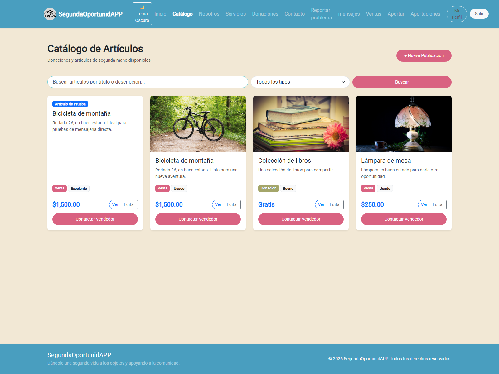
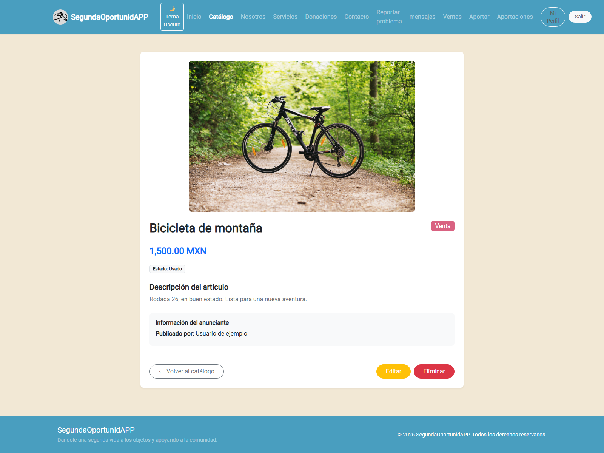
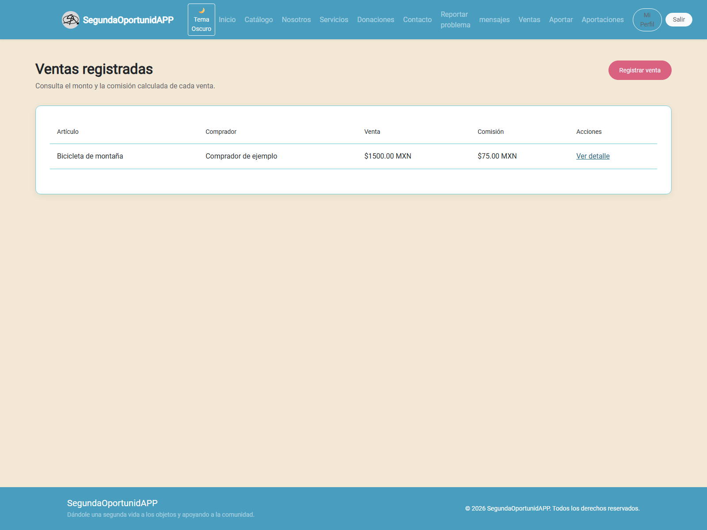
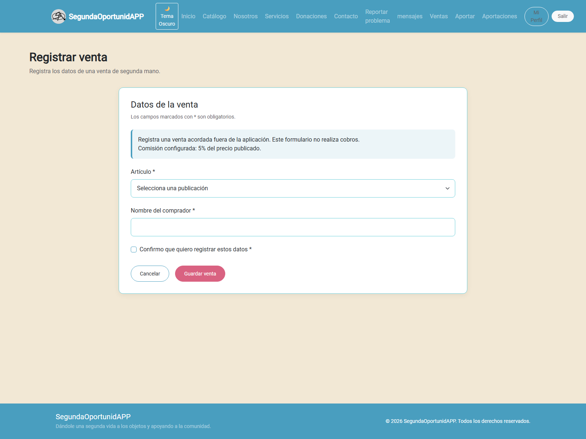
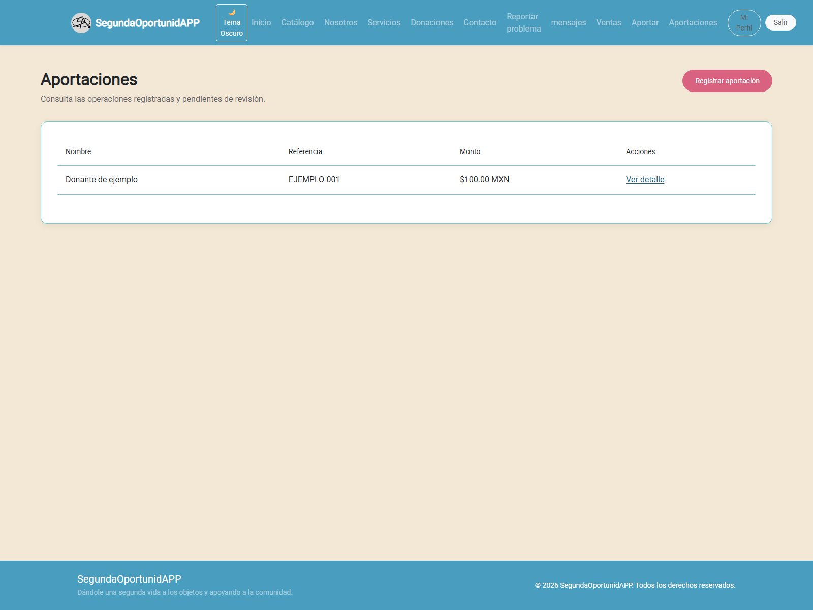
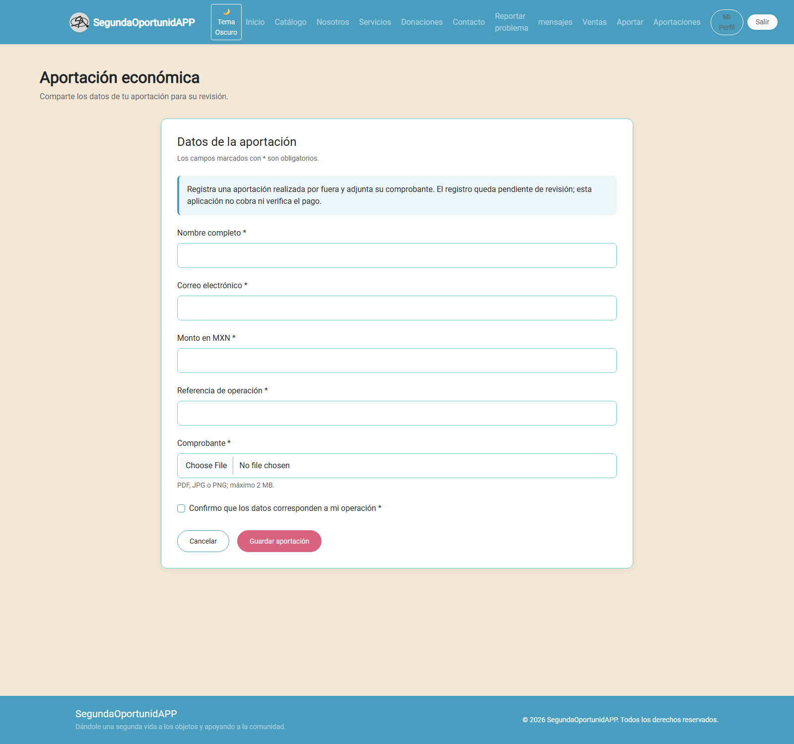
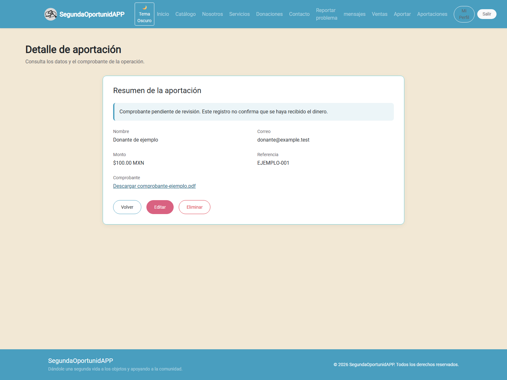

# SegundaOportunidAPP

Aplicación web desarrollada con **Laravel** y **PostgreSQL** para la compra, venta e intercambio de artículos de segunda mano, incluyendo gestión de publicaciones, transacciones, mensajería interna y reportes.

- **Institución:** Universidad Politécnica de Pachuca
- **Programa Educativo:** Tecnologías de la Información e Innovación Digital
- **Asignatura:** Aplicaciones Web (Septiembre–Diciembre 2026)
- **Docente:** Maestra Yeniza Sarahi Montoya Martínez
- **Repositorio:** `https://github.com/anhilvigueras-debug/SegundaOportunidAPP`

---

## Integrantes del equipo

- **Anhil Vigueras Mendoza**
- **Zayra Olvera Hernández**
- **Luis Uriel Azpeitia Escamilla**
- **Ángel Daniel Martínez Rendón**
- **Marco Antonio Zarco Espinoza**
- **Diego Pérez Cervantes**

---

## Estructura de directorios del proyecto

Arquitectura **MVC** de Laravel organizada por módulos:

```text
SegundaOportunidAPP/
├── app/
│   ├── Http/
│   │   └── Controllers/          # Lógica de controladores RESTful (ReporteController, etc.)
│   ├── Models/                   # Modelos Eloquent con $fillable y relaciones (User, Publicacion, Transaccion, Conversacion, Mensaje, Reporte)
│   └── Providers/                # Proveedores de servicios de la aplicación
├── bootstrap/                    # Arranque y caché del framework
├── config/                       # Configuración de base de datos (pgsql), sesiones y app
├── database/
│   ├── factories/                # Fábricas de datos de prueba
│   ├── migrations/               # Esquema relacional en PostgreSQL (users, publicacions, transacciones, conversaciones, mensajes, reportes)
│   └── seeders/                  # Poblado inicial de datos (DatabaseSeeder)
├── docs/                         # Documentación técnica complementaria
├── public/                       # Punto de entrada (index.php) y recursos públicos compilados
├── resources/
│   ├── css/                      # Hojas de estilo fuente
│   ├── js/                       # Scripts frontend
│   └── views/                    # Plantillas Blade organizadas por módulo con layout compartido
│       ├── layouts/              # Plantilla base (@extends / @section)
│       ├── publicacions/         # Vistas CRUD de publicaciones
│       ├── transacciones/        # Vistas CRUD de transacciones
│       ├── conversaciones/       # Vistas de mensajería y chat
│       └── reportes/             # Vistas CRUD de reportes
├── routes/
│   └── web.php                   # Definición de rutas RESTful (Route::resource)
├── .env.example                  # Plantilla de variables de entorno sin credenciales reales
├── composer.json                 # Dependencias de PHP / Laravel
└── package.json                  # Dependencias frontend (Vite / Tailwind)
```

---

## Requisitos previos

Para ejecutar este proyecto en un entorno local es necesario contar con:

- **PHP >= 8.3** (con las extensiones `pdo_pgsql` y `pgsql` habilitadas en `php.ini`).
- **Composer** (gestor de dependencias de PHP).
- **PostgreSQL >= 14** en ejecución.
- **Node.js y NPM** (para compilar los estilos y recursos con Vite).

---

## Instalación y ejecución desde cero

Sigue estos pasos después de clonar el repositorio:

### 1. Clonar el proyecto e ingresar a la carpeta

```bash
git clone https://github.com/anhilvigueras-debug/SegundaOportunidAPP.git
```

### 2. Instalar dependencias de backend y frontend

```bash
composer install
npm install
npm run build
```

### 3. Configurar el archivo de entorno (`.env`)

Crea tu archivo `.env` a partir de la plantilla `.env.example` y genera la clave de aplicación de Laravel:

```bash
cp .env.example .env
php artisan key:generate
```

### 4. Configurar la conexión a PostgreSQL

Crea una base de datos vacía en PostgreSQL llamada `segunda_oportunidad` y edita las siguientes variables dentro de tu archivo `.env`:

```env
DB_CONNECTION=pgsql
DB_HOST=127.0.0.1
DB_PORT=5432
DB_DATABASE=segunda_oportunidad
DB_USERNAME=postgres
DB_PASSWORD=tu_contraseña_local
```

### 5. Ejecutar migraciones y seeders

Construye la estructura de tablas y carga los datos iniciales:

```bash
php artisan migrate --seed
```

**Para reiniciar una base de pruebas**, se puede usar `php artisan migrate:fresh --seed`. Este comando elimina todas las tablas y sus datos; no lo uses en una base con información que quieras conservar.

### 6. Levantar el servidor local

```bash
php artisan serve
```

Accede desde tu navegador a: **`http://127.0.0.1:8000`**

---

## Flujo de ejemplo

Crear una publicación de tipo venta con precio mayor que cero, abrir Ventas y registrar el comprador. El importe se toma del precio de la publicación y se guarda junto con la comisión y el saldo del vendedor. Una publicación admite una sola venta; para conservar la integridad, no puede borrarse mientras exista el registro de venta.

Desde Aportar se registran nombre, correo, monto, referencia única y comprobante PDF/JPG/PNG (máximo 2 MB). El archivo se guarda en la base como texto codificado y puede descargarse. Registrar un comprobante no demuestra que la operación se haya realizado. Se pueden consultar, editar y eliminar los registros.

`COMISION_PUNTOS_BASE=500` en `.env` representa un **5% de ejemplo**, no una tarifa aprobada: 100 puntos base equivalen a 1%. El equipo puede cambiar el valor de 0 a 10000 antes de registrar nuevas ventas. Cada venta conserva la tasa vigente en el momento de su registro; editar el comprador no altera sus importes. La comisión se redondea al centavo más cercano.

## Pruebas

Las pruebas utilizan SQLite en memoria por defecto al ejecutar `php artisan test`.

Después de adaptar las vistas de ventas y aportaciones a la guía de diseño, se ejecutaron 8 pruebas con SQLite en memoria y pasaron 90 verificaciones. Estas pruebas incluyeron que las pantallas del módulo cargaran sus estilos y acciones.

El 16 de noviembre de 2026 se probó el commit `0c6adcd` con PostgreSQL en una base de datos creada exclusivamente para pruebas. Se ejecutaron `php artisan migrate` y `php artisan migrate:fresh --seed` sin errores; después, las 7 pruebas pasaron con 62 verificaciones. Las pruebas abarcaron el cálculo de comisión, validaciones, comprobantes y acceso a las pantallas.

La rama recibió posteriormente un ajuste en `composer.lock` para compatibilidad con PHP 8.3. Se recomienda repetir las pruebas con PostgreSQL tras instalar las dependencias de la versión actual. El comando `migrate:fresh` elimina todas las tablas de la base configurada: úsalo solo en una base de pruebas independiente.

---

## Módulos CRUD y Arquitectura del Sistema

El sistema implementa rutas RESTful (`Route::resource`), plantillas **Blade** con layout compartido y persistencia relacional en **PostgreSQL**:

1. **Publicaciones (`publicacions`):** Creación, listado con filtros/búsqueda, edición con precarga de datos y eliminación controlada de artículos.
2. **Ventas y aportaciones (`ventas` y `aportaciones`):** Registro manual de ventas, cálculo de comisión y registro de aportaciones con comprobante.
3. **Mensajería (`conversaciones` y `mensajes`):** Hilos de comunicación directa asociados a publicaciones y usuarios.
4. **Reportes (`reportes`):** Gestión completa (CRUD) de reportes sobre publicaciones con estados y trazabilidad.
5. **Usuarios (`users`):** Registro, autenticación y administración de perfiles de usuario.

### Aportaciones individuales por integrante

#### Anhil Vigueras Mendoza — Catálogo, Búsqueda, Detalle y Estado de Publicaciones

En este módulo me encargué de crear las vistas y funciones para consultar y gestionar las publicaciones dentro de la plataforma. Programé el catálogo público para que mostrara únicamente los artículos disponibles, añadiendo un buscador por palabras clave (sin importar mayúsculas o minúsculas) y un filtro para separar entre ventas y donaciones, manteniendo siempre visibles las opciones que el usuario seleccionó.

También trabajé en la vista de detalle de cada artículo para que, al entrar a una publicación, cualquier persona interesada pueda ver toda su información junto con el nombre, ciudad y teléfono del dueño para ponerse de acuerdo en la entrega. Por último, integré dentro del perfil del usuario el historial completo de sus publicaciones y añadí el botón para marcar un artículo como finalizado; al usarlo, el sistema verifica que sea el dueño real, pide confirmación y oculta automáticamente la publicación del catálogo público sin borrar su registro de la base de datos.

### Marco Antonio Zarco Espinoza — Ventas, comisiones y aportaciones

En este módulo me encargué de desarrollar el registro de ventas de artículos de segunda mano y el cálculo automático de la comisión correspondiente a SegundaOportunidAPP. Integré las ventas con las publicaciones para guardar en la base de datos el monto de la operación, el porcentaje aplicado, la comisión y el importe restante para el vendedor. También agregué una validación para evitar registrar dos ventas de la misma publicación y una protección para impedir que se elimine una publicación mientras tenga una venta registrada.

Además, elaboré un formulario para registrar aportaciones económicas con el nombre, correo, monto y referencia de la operación. Incorporé la carga y descarga de comprobantes en formato PDF, JPG o PNG, así como validaciones y mensajes de error en español. Implementé opciones para consultar, editar y eliminar los registros, y adapté las vistas al diseño y al footer del proyecto.

Para mantener la identidad visual de SegundaOportunidAPP, adapté los formularios, listados y detalles de ventas y aportaciones a la guía de diseño del equipo. Utilicé la paleta y tipografía del proyecto, espaciados consistentes y una distribución adaptable a computadoras y celulares. Conservé la navegación y el footer compartidos, e integré la confirmación de eliminación mediante eventos de JavaScript.

Por último, participé en la integración de los cambios recientes de `main` con la rama del módulo y en las pruebas de migraciones y funcionalidades con PostgreSQL. El registro de ventas y aportaciones es manual: todavía no realiza cobros ni verifica pagos automáticamente, y el módulo necesita controles de autorización antes de utilizar datos reales.

## Capturas del módulo de publicaciones

### Catálogo



### Crear publicación


### Detalle de publicación



### Editar publicación


## Capturas del módulo de ventas y aportaciones

Las capturas muestran la interfaz de la aplicación con datos ficticios.

### Listado de ventas



### Registrar una venta



### Detalle de una venta y su comisión


### Listado de aportaciones



### Registrar una aportación



### Detalle y comprobante de una aportación


