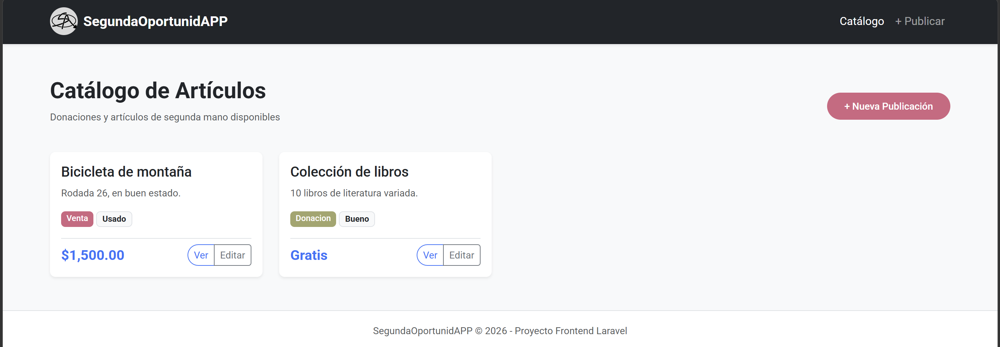
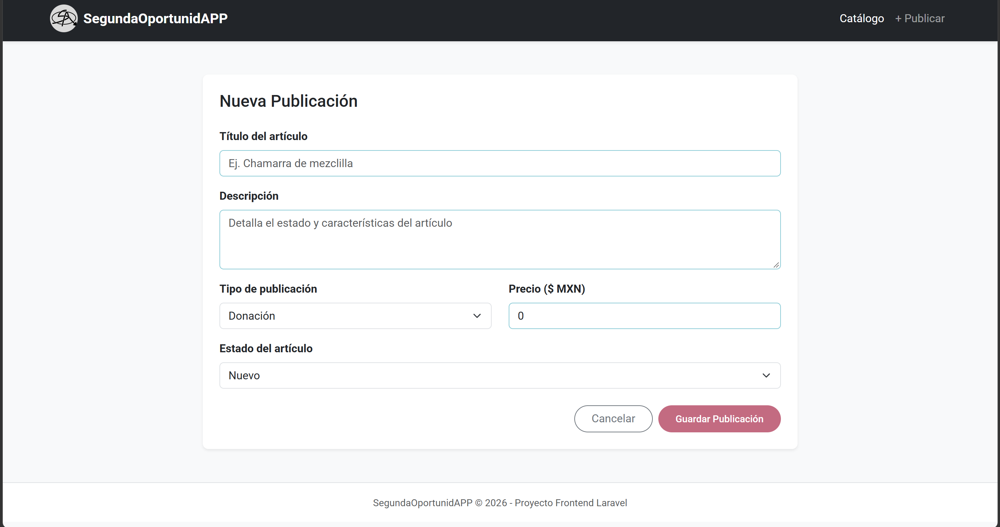
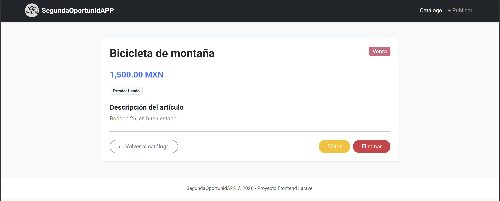
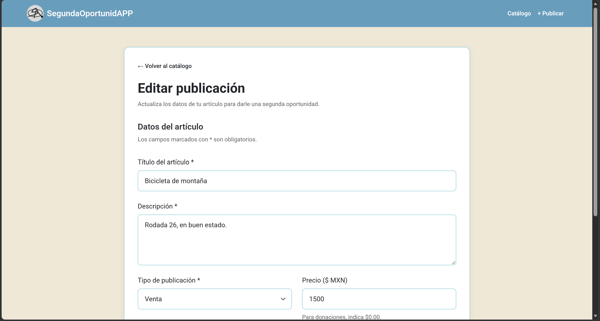

<<<<<<< HEAD
<p align="center"><a href="https://laravel.com" target="_blank"></a></p>

<p align="center">
<a href="https://github.com/laravel/framework/actions"></a>
<a href="https://packagist.org/packages/laravel/framework"></a>
<a href="https://packagist.org/packages/laravel/framework"></a>
<a href="https://packagist.org/packages/laravel/framework"></a>
</p>

## About Laravel

Laravel is a web application framework with expressive, elegant syntax. We believe development must be an enjoyable and creative experience to be truly fulfilling. Laravel takes the pain out of development by easing common tasks used in many web projects, such as:

- [Simple, fast routing engine](https://laravel.com/docs/routing).
- [Powerful dependency injection container](https://laravel.com/docs/container).
- Multiple back-ends for [session](https://laravel.com/docs/session) and [cache](https://laravel.com/docs/cache) storage.
- Expressive, intuitive [database ORM](https://laravel.com/docs/eloquent).
- Database agnostic [schema migrations](https://laravel.com/docs/migrations).
- [Robust background job processing](https://laravel.com/docs/queues).
- [Real-time event broadcasting](https://laravel.com/docs/broadcasting).

Laravel is accessible, powerful, and provides tools required for large, robust applications.

## Learning Laravel

Laravel has the most extensive and thorough [documentation](https://laravel.com/docs) and video tutorial library of all modern web application frameworks, making it a breeze to get started with the framework.

In addition, [Laracasts](https://laracasts.com) contains thousands of video tutorials on a range of topics including Laravel, modern PHP, unit testing, and JavaScript. Boost your skills by digging into our comprehensive video library.

You can also watch bite-sized lessons with real-world projects on [Laravel Learn](https://laravel.com/learn), where you will be guided through building a Laravel application from scratch while learning PHP fundamentals.

## Agentic Development

Laravel's predictable structure and conventions make it ideal for AI coding agents like Claude Code, Cursor, and GitHub Copilot. Install [Laravel Boost](https://laravel.com/docs/ai) to supercharge your AI workflow:

```bash
composer require laravel/boost --dev

php artisan boost:install
=======
# SegundaOportunidAPP · Laravel

Proyecto académico de publicaciones, ventas y aportaciones. Las ventas se registran manualmente y se calcula la comisión; las aportaciones guardan su comprobante en la base de datos para revisión. **No hay pasarela de pagos, cobro real ni verificación automática**. La aplicación incluye inicio de sesión para usuarios, pero el módulo de transacciones todavía necesita controles de autorización. Utiliza solo datos de prueba y no lo despliegues con comprobantes reales.

## Requisitos

PHP 8.3 o superior con las extensiones `pdo_pgsql` y `pgsql`, Composer y PostgreSQL. Bootstrap se carga desde CDN.

## Instalación desde cero (PowerShell)

1. Crear una base de datos vacía en PostgreSQL, por ejemplo `segunda_oportunidad`, usando pgAdmin o `createdb`.
2. En la carpeta del proyecto:

```powershell
composer install
Copy-Item .env.example .env
>>>>>>> bef5656943fd3c12a54aed6dbb0598a3aa448368
```

3. Editar `.env`: completar `DB_HOST`, `DB_PORT`, `DB_DATABASE`, `DB_USERNAME` y `DB_PASSWORD` con los datos locales. No compartir ni subir `.env`.
4. Ejecutar:

```powershell
php artisan key:generate
php artisan migrate --seed
php artisan serve
```

Abrir la dirección que muestre Artisan. Para comenzar de nuevo con datos de ejemplo, usar `php artisan migrate:fresh --seed`. **Este último comando elimina todas las tablas y sus datos**; úsalo únicamente en una base de pruebas.

## Flujo de ejemplo

Crear una publicación de tipo venta con precio mayor que cero, abrir Ventas y registrar el comprador. El importe se toma del precio de la publicación y se guarda junto con la comisión y el saldo del vendedor. Una publicación admite una sola venta; para conservar la integridad, no puede borrarse mientras exista el registro de venta.

Desde Aportar se registran nombre, correo, monto, referencia única y comprobante PDF/JPG/PNG (máximo 2 MB). El archivo se guarda en la base como texto codificado y puede descargarse. Registrar un comprobante no demuestra que la operación se haya realizado. Se pueden consultar, editar y eliminar los registros.

`COMISION_PUNTOS_BASE=500` en `.env` representa un **5% de ejemplo**, no una tarifa aprobada: 100 puntos base equivalen a 1%. El equipo puede cambiar el valor de 0 a 10000 antes de registrar nuevas ventas. Cada venta conserva la tasa vigente en el momento de su registro; editar el comprador no altera sus importes. La comisión se redondea al centavo más cercano.

Las pruebas usan SQLite en memoria para no tocar la base PostgreSQL configurada: `php artisan test`. Debe probarse también `migrate` y `migrate:fresh --seed` en una base PostgreSQL independiente.

<<<<<<< HEAD
The Laravel framework is open-sourced software licensed under the [MIT license](https://opensource.org/licenses/MIT).
=======

## Integrantes del equipo

- Anhil
- Luis
- Angel Daniel
- Marco
- Zayra
- Diego

## Capturas del módulo de publicaciones

### Catálogo



### Crear publicación



### Detalle de publicación



### Editar publicación


>>>>>>> bef5656943fd3c12a54aed6dbb0598a3aa448368
